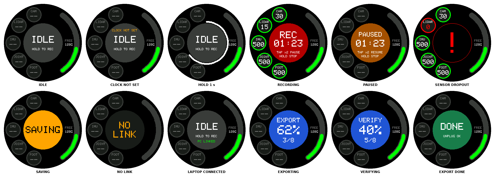

# Go2 Record Pipeline

Records IMU, joint states, foot forces, an attached RealSense D435I, and
LiDAR on the Go2's Jetson. Recording can be controlled by the robot's round
screen or by the laptop camera backend. Files stay on the Jetson until copied.

For daily operation, see the [User Guide](https://github.com/yuzhench/go2_data_collection).
This README covers installation, data formats and development.

## Install on the Jetson

Copy the repository from the laptop (replace `<jetson_ip>`):

```bash
rsync -avz --exclude='.git/' --exclude='data/' --exclude='__pycache__/' \
  ~/Desktop/Research/Harvard_AI/go2_record_pipeline/ \
  unitree@<jetson_ip>:~/Desktop/go2_record_pipeline/
```

On the Jetson, use the existing `go2` environment:

```bash
cd ~/Desktop/go2_record_pipeline
conda activate go2
pip install -e unitree_sdk2_python/
pip install -r requirements.txt
sudo usermod -aG dialout unitree
```

Log out and back in after changing groups. Install a `pyrealsense2` build
compatible with the Jetson's Python and JetPack versions. Check the drivers:

```bash
python -c 'import pyrealsense2; import unitree_sdk2py.core.channel'
```

Production collectors fail if a required driver is missing. Synthetic data
requires an explicit `mock=True`; the daemon does not enable it.

Check `jetson/config.py` and the paths in `jetson/record_daemon.service`.
The supplied service expects `/home/unitree/miniconda3/envs/go2`, an aarch64
Jetson, DDS on `eth0`, and data in `/home/unitree/GO2_DATA`.

```bash
sudo bash jetson/install_daemon.sh
systemctl status record_daemon --no-pager
journalctl -u record_daemon -f
```

For debugging, stop the system service before starting an interactive daemon:

```bash
sudo systemctl stop record_daemon
python -m jetson.record_daemon
```

After updating code, restart the service only when recording and export have finished.

## Record with the screen



1. Power on the screen with its side button. Wait for `IDLE`. `NO LINK`
   means it is not receiving daemon status; check USB and the service.
   `CLOCK NOT SET` means the Jetson's clock has not been set since it was
   switched on: connect the laptop and open the offload tool first.
2. Check `FREE`. At 640×480 and 30 Hz, depth alone uses about 1.1 GB/min;
   RGB and LiDAR add to this.
3. Hold the centre for one second to start. Samples are kept from two
   seconds after the request.
4. Watch the rates. A stream below half its configured reference for three
   seconds turns red; recovery takes one second above the threshold.
   Recording continues during the warning.
5. Double-tap the centre to pause, and again to resume. Nothing is kept while
   `PAUSED`; the timer counts recorded time only. The session stays one
   folder and `session_meta.json` lists the pauses.
6. Hold the centre for one second to stop (also from `PAUSED`). Wait for
   `SAVING` to finish and `IDLE` to return before powering off. `ERROR` means
   a start or stop failed; see the daemon log.

| Display | Stream | Alarm reference |
|---|---|---|
| CAM | Color and aligned depth | 30 Hz |
| LIDAR | DDS point-cloud messages | 9 Hz |
| IMU / JOINT / FOOT | Fields of the same `rt/lowstate` message | 500 Hz each |

A writer failure forces the corresponding displayed rate to zero.

Screen recordings use
`<DATA_ROOT>/unlabeled/<MM_DD_YYYY>/<HH_MM_SS>/first_person/`.
If a locally generated name already exists, a numeric suffix prevents overwrite.

The firmware is in `screen/firmware/` (EC Buying 1.28-inch ESP32-S3 board;
pins in `include/board_pins.h`). Lab members flash a prebuilt image from branch
`screen-firmware` of `robot_dog_data_web`, and update the Jetson with
`update_robot.py` from branch `jetson-recorder`. With PlatformIO installed:

```bash
cd screen/firmware
pio run -t upload
```

For screen-only testing, `python screen/tools/sim_feed.py` sends simulated status.

## Record with laptop cameras

Start [camera_record_pipeline](https://github.com/yuzhench/Harvard_AI_Robotics_cameras_recording_system)
with `JETSON_URL=http://<jetson_ip>:8010`, then use its web UI. The camera
backend assigns a shared date/time folder and forwards start/stop to the Jetson.
`laptop/master_record.py` uses the same backend; its `--host` option changes
only the Jetson status query, not the backend's `JETSON_URL`.

The two machines write separate `first_person/` and
`third_person/` trees. Copying matching session folders merges these trees.

## Copy data

Run the separate [offload tool](https://github.com/yuzhench/go2_data_collection)
on a laptop connected to the robot's Ethernet port. It copies selected
sessions, compares SHA-256 checksums, then asks which sessions to delete.

The lab Jetson's one-time support installation is:

```bash
sudo bash jetson/install_offload_support.sh
```

This requires `dnsmasq-base`. It installs DHCP on `eth0`, periodic clock
saving, boot-time clock restoration, and permission to set time from the
laptop. It assumes the lab's `192.168.123.0/24` network. The offload tool's
default endpoint is `192.168.123.18:8010`.

`PC LINKED` appears after the offload tool communicates with the daemon,
not merely when a cable is inserted. Active export phases block new
recordings while their heartbeat remains current; the lease expires after
five seconds without an update. Use one offload client at a time.

The Jetson has no clock battery: at boot it restores the last saved time.
Connecting the offload tool sets the clock (`POST /time`), so connect once
before recording; until then the screen shows `CLOCK NOT SET` (a chrony sync
also counts). Recordings made before the clock was set get
`first_person/clock_correction.json` when it is set, as long as the robot was
not switched off in between (`jetson/clock.py`): add its `offset_s` to every
timestamp of that recording to get the real time. The recorded files are not
changed, and the session folder keeps its (wrong) date and time.

## Files and conversion

Collectors append raw files during recording. Camera and LiDAR queues are
bounded; excess samples are dropped and counted. IMU backlog overflow is
reported as an error. Writers periodically call `fsync`.

Convert **stopped** sessions on the Jetson or after copying to a laptop:

```bash
python scripts/finalize_session.py /path/to/data
# After checking the result, optionally remove raw inputs:
python scripts/finalize_session.py /path/to/data --delete-raw
```

Conversion stages outputs before replacing existing files. It validates JPEGs,
checks the encoded video by decoding it, and checks indexed LiDAR files.
Incomplete trailing records are ignored; camera recovery keeps the complete
prefix. A corrupt JPEG or a missing indexed LiDAR scan stops conversion and
preserves raw inputs. Do not record into or export a session during conversion.

| Raw input under `first_person/` | Converted output |
|---|---|
| `lowstate.bin` | `imu.npz`, `joints.npz`, `contacts.npz` |
| `ego_cam/rgb.mjpeg`, `ego_cam/frames.bin` | `ego_cam/rgb.mp4`, `ego_cam/rgb_timestamps.npy` |
| `ego_cam/depth.raw`, `ego_cam/frames.bin` | `ego_cam/depth.npz` |
| `lidar_timestamps.bin` | `lidar_timestamps.npy` |
| `lidar/*.npy`, calibration and session metadata | Retained; LiDAR count is updated |

- IMU: quaternion `(w,x,y,z)`, angular velocity, acceleration, roll/pitch/yaw.
- Joints: `q`, `dq`, `tau` for 12 joints; joint names are stored in the NPZ.
- Foot forces: four reported values in FR, FL, RR, RL order, not binary contact labels.
- Depth: `(N,H,W)` uint16 plus timestamps; multiply by `depth_scale` for metres.
  Saved depth is aligned to color. `intrinsics.json` records its color geometry
  and retains native depth calibration as `depth_native` for new recordings.
  Older recordings may label native depth intrinsics as `depth`.
- Video: MPEG-4 (`mp4v`) at the median frame rate, with per-frame timestamps
  stored separately; pauses are cut out of the video. Use the timestamps for
  alignment.
- LiDAR: one `(N,4)` float32 array per message, with columns x/y/z/intensity.
  Missing intensity is zero. `lidar_meta.json` records the reported frame ID.
- `session_meta.json`: task, prompt, planned start time, recorded seconds,
  pauses (`[[start, end], ...]`, Unix time), counts and collector summaries. `clean_stop` is false if shutdown reported an error. Mock sessions are labelled.
  `clock` is `{boot_id, boot_epoch, trusted}`: whether the clock had been set when recording started, and the data
  needed to correct it later.
- `clock_correction.json` (only for recordings made before the clock was set): `offset_s` (real time = recorded
  time + `offset_s`), the corrected `start_time`, and how the clock was set.

## Timing

Timestamps are host Unix times: IMU and LiDAR at message receipt, camera
after RealSense frame alignment.

`POST /resync_clock` restarts chrony and reports convergence. It is rejected
while recording or saving. It needs passwordless sudo for
`/usr/bin/systemctl restart chrony`; the lab configuration is in
[the setup notes](GO_NOTES/control_architecture.md).

## API and development

The daemon listens on port 8010. Protocol version is 4, matching the laptop
backend.

| Endpoint | Behaviour |
|---|---|
| `POST /start` | Body: `task`, optional `prompt`, `session_date` (`MM_DD_YYYY`), `session_id` (`HH_MM_SS`). Existing explicit IDs are rejected. |
| `POST /stop` | Stop capture, drain writers, close files; reports failure if a collector cannot save cleanly. |
| `POST /pause`, `POST /resume` | Keep the session open but keep no data in between. |
| `GET /status` | State, `paused`, `clock_set`, recorded time, counts, rates, screen connection, current session, `code_version`. |
| `POST /resync_clock` | Restart chrony and report convergence. |
| `/sessions…`, `/export/state`, `/time` | Export and clock APIs; see `jetson/export_api.py`. |

Lifecycle operations are serialized. Status remains readable while starting
or saving. The recorder uses `idle → recording → saving → idle`; the initial
`recording` state includes collector startup. A failed startup stops any
collectors already started and returns to idle.

Hardware-free checks:

```bash
conda activate go2
python -B -m unittest discover -s tests -v
python scripts/test_collectors.py --mock --duration 5
```

For a hardware collector check, omit `--mock` and set `--interface eth0`.
Each run uses a new directory under `data/test_session/`.
The keyboard control script sends motion continuously after a keypress:
Space stops motion; Q or Ctrl-C exits. Its `1`/`2` keys are stand up/down.

`GO_NOTES/` contains earlier setup records. For current file layouts and
operator steps, use this README and the User Guide.
